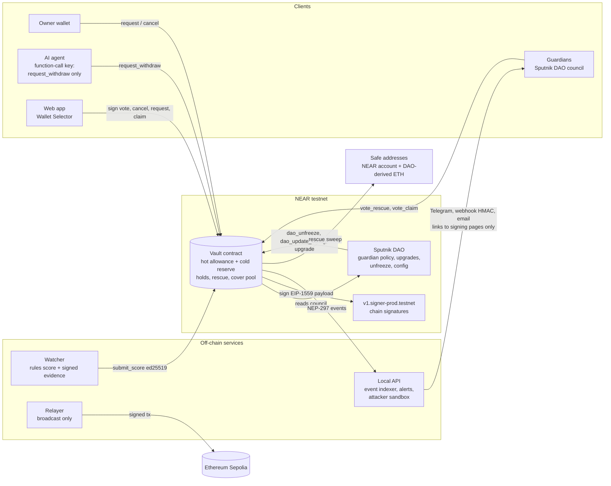

# Rescue Room

A hold-and-rescue safety layer for DAO treasuries and AI agents on NEAR, with Sepolia ETH controlled through NEAR chain signatures.

When a stolen key or a confused agent starts moving money, the vault holds the withdrawal, a watcher explains why it looks risky, and guardians from your Sputnik DAO can rescue the funds to a pre-set safe address. Small everyday spends still go through instantly.

> Status: phase 2, NEAR testnet and Ethereum Sepolia only. Not audited. Do not use with real funds.

## Architecture



## How it works

| Piece | What it does |
| --- | --- |
| Hot allowance | Spends up to a limit per rolling window execute instantly (NEAR and Sepolia ETH tracked separately). |
| Risk-scored holds | Anything beyond the allowance waits. Hold length comes from a 0-100 risk score: 0-29 none, 30-59 1h, 60-79 3h, 80+ 6h, never below `hold_floor_secs` (30 min on the demo vault). Unscored requests get the longest hold. A demo divisor turns hours into minutes. |
| Watcher (off-chain) | Deterministic rules score each held request (new destination, chunked drain, unusual size, share of reserve, off-rhythm time, signing-pattern change, agent paying an unlisted address, fresh whitelist). It hashes an evidence bundle, signs `rescueroom-score:v1:<vault>:<id>:<score>:<confidence>:<sha256>` with an ed25519 key, and the contract verifies that signature before storing the score. The optional LLM explainer (NEAR AI Cloud) only writes the explanation. |
| Owner cancel | The owner can cancel any held request instantly. |
| Guardians | Members of a role (default `council`) in an existing Sputnik DAO, synced on-chain from `get_policy`. Rescue needs `quorum_pct` of guardians and at least `min_distinct` approvers. |
| Rescue | Blocks the request, cancels every other open request, revokes the agent key that made it, sweeps the NEAR reserve (or signs the ETH amount) to the safe address, and freezes the vault until a DAO proposal calls `dao_unfreeze`. |
| Chain signatures | For Sepolia ETH the vault builds the EIP-1559 transaction itself (RLP and keccak in the contract), asks `v1.signer-prod.testnet` to sign it, and stores the signature. The relayer only broadcasts. |
| Cover pool | Underwriters deposit NEAR. Premiums are priced from the vault's own risk posture. Payouts are capped per incident and need the guardian quorum. Cover is for what holds cannot stop: losses inside the hot allowance. |
| Agent keys | `add_agent_key` puts a function-call key on the vault that can only call `request_withdraw`. A rescue revokes it. |
| No owner backdoor | The vault account has no access keys after deployment (`scripts/lock-vault.mjs`). Code changes only happen through a guardian DAO proposal that calls `upgrade`, which only accepts the DAO as caller and runs `migrate`. |
| Audit log | Every action emits a NEP-297 event (`standard: "rescueroom"`). The local API indexes them from testnet and the app shows each with an explorer link. |
| Alerts | Event-driven: holds (score 30+), rescues, claims, unfreezes, upgrades and failures go to Telegram, a signed webhook and email. Buttons only open signing pages that show the exact call. |
| Attacker sandbox | "Run attacker" on the "Try to drain it" page runs the scripted drain against a separate sandbox vault through the local API (rate limited), streams each step and shows hot allowance lost against reserve kept. The vault resets after each run. |

## Live on NEAR testnet

Current ids are in [`deploy/testnet.json`](deploy/testnet.json) and [`deploy/sandbox.json`](deploy/sandbox.json).

| | Account |
| --- | --- |
| Demo treasury vault (locked, v1.1.1) | [`vault-v2.rescueroom-j60ox4.testnet`](https://testnet.nearblocks.io/address/vault-v2.rescueroom-j60ox4.testnet) |
| Attacker sandbox vault (locked) | [`sandbox.rescueroom-j60ox4.testnet`](https://testnet.nearblocks.io/address/sandbox.rescueroom-j60ox4.testnet) |
| Guardian DAO (council g1, g2, g3; 2 of 3) | [`rescueroom-j60ox4-guardians.sputnik-v2.testnet`](https://testnet.nearblocks.io/address/rescueroom-j60ox4-guardians.sputnik-v2.testnet) |
| Vault's Sepolia address (MPC path `rescueroom-eth-1`) | [`0xFAF0Db5471b9DfD6876D349CBcAe33a6985ED31f`](https://sepolia.etherscan.io/address/0xFAF0Db5471b9DfD6876D349CBcAe33a6985ED31f) |
| Sepolia safe address (derived from the DAO account) | [`0xf55b4654d6761e1F3EdEDD2f1c480FB4fD97911F`](https://sepolia.etherscan.io/address/0xf55b4654d6761e1F3EdEDD2f1c480FB4fD97911F) |

## Setup

Requirements: Node 22+, Rust stable 1.95+ with `wasm32-unknown-unknown`, `cargo-near` 0.23, and a funded NEAR testnet account.

```bash
npm install && (cd web && npm install)
cp .env.example .env            # every integration is optional; see below
npm test                        # 30 contract tests + 13 watcher, alert and API tests
npm run build:contract

node scripts/deploy.mjs <main>.testnet          # roles, guardian DAO, demo vault
node scripts/lock-vault.mjs                     # delete the vault's full-access key
npm run deploy:sandbox                          # separate vault for the public attacker sandbox
node scripts/lock-vault.mjs sandbox.<main>.testnet

npm run e2e                     # every scenario on testnet, logs to deploy/e2e-*.json
npm run api                     # indexer, alerts and sandbox API on 127.0.0.1:8787
npm run web                     # http://127.0.0.1:5173 (proxies /api)
```

Keys are generated into `~/.rescueroom/keys/*.json` with mode 600. The web app never sees a key; it signs through the user's own wallet.

Optional integrations, each switched on by its env vars in `.env`:

| Feature | Env vars | Without them |
| --- | --- | --- |
| LLM explanation of scores | `NEAR_AI_API_KEY`, `NEAR_AI_MODEL` | template explanation |
| Telegram alerts | `TELEGRAM_BOT_TOKEN`, `TELEGRAM_CHAT_ID`, and a public https `APP_URL` for URL buttons | skipped (links go in the text if `APP_URL` is not https) |
| Webhook alerts | `ALERT_WEBHOOK_URL`, `ALERT_WEBHOOK_SECRET` | skipped |
| Email alerts | `SMTP_URL`, `ALERT_EMAIL_TO`, `ALERT_EMAIL_FROM` | skipped |
| Sepolia sends | ETH at the vault's Sepolia address (gas) | signatures are produced and verified, not broadcast |
| Public sandbox | a public URL in front of `npm run api` with `TRUST_PROXY=1` | localhost only |

Webhook receivers verify `X-RescueRoom-Signature: sha256=<hex>` = HMAC-SHA256(secret, `<X-RescueRoom-Timestamp>.<raw body>`) and reject timestamps older than 5 minutes. `verifyWebhook()` in `alerts/src/channels.js` does both.

## Upgrades go through the DAO

The vault account has no access keys, so no one can deploy code or sign as the vault. To upgrade:

```bash
node scripts/dao-upgrade.mjs path/to/new.wasm 1.1.1
```

This opens a Sputnik `FunctionCall` proposal to `vault.upgrade(<wasm bytes>)`; when two guardians approve, the DAO calls it, the vault checks the caller is the DAO, deploys the code and calls `migrate`. Sputnik's `UpgradeRemote` blob path keeps only 15 Tgas for itself after forwarding the code, which a ~345 KB wasm exceeds on the testnet factory version, so the inline path is the default (`UPGRADE_MODE=blob` uses the blob path for smaller code).

Proof on testnet: full-access key deleted in [`9rfXEqGQ`](https://testnet.nearblocks.io/txns/9rfXEqGQnhTbQCMS3Xde3FW8E741me7FqtySwqWJxicV); DAO proposal 7 upgraded 1.1.0 to 1.1.1 in [`4q2TYvmy`](https://testnet.nearblocks.io/txns/4q2TYvmy6orAuEsbLMSo4fE7EJwnj9g9SLrbGckyJ1VJ) (events `upgrade_started`, `upgraded`). A direct call to `upgrade` from any other account fails with "only guardian DAO".

## Demo run

All scenarios were re-run on the locked, upgraded vault on 10 Nov 2026. Times are WAT.

**Rescue: stolen agent key drains in chunks**

| WAT | Step | Tx |
| --- | --- | --- |
| 11:37:16 | Underwriter funded cover pool with 2 NEAR | [`5Z22u1Z8`](https://testnet.nearblocks.io/txns/5Z22u1Z8Y6uWVJ4YZn4nFi2iwHCKcvpnHSu95N7NiRoS) |
| 11:37:19 | Owner bought 1 NEAR of cover (premium 0.0268 NEAR) | [`Cv3uG4tX`](https://testnet.nearblocks.io/txns/Cv3uG4tXuvyeQmLyVsrnwBUZoHmCS96FvTQULaVMnQTu) |
| 11:37:22 | Owner gave the AI agent a request-only key | [`EasDaZsN`](https://testnet.nearblocks.io/txns/EasDaZsNKvFJhJpEvbK5YRhEr46mKYwW1my1zwxeXJxx) |
| 11:37:26 | Attacker (stolen agent key) requested 0.8000 NEAR | [`AVXY1cKz`](https://testnet.nearblocks.io/txns/AVXY1cKzzGXCQnnPrnzPAuRqY8F1YWokrPLScZBqXo6S) |
| 11:37:28 | Attacker (stolen agent key) requested 0.5000 NEAR | [`7H6yUk3H`](https://testnet.nearblocks.io/txns/7H6yUk3HDqdvXBR8DyanugkgxBRy6JR64JrXpKEhJjuk) |
| 11:37:29 | Attacker (stolen agent key) requested 2.0000 NEAR | [`GbJQXoH3`](https://testnet.nearblocks.io/txns/GbJQXoH3UbsRoTEKHJ7K4sBfbvt4jXuVmJcJDWKcyz3Z) |
| 11:37:34 | Watcher scored the drain (score 65, signals chunked_drain,large_share_of_reserve,agent_unlisted_destination) | |
| 11:37:37 | Guardian g1 voted rescue | [`GWwCmHEc`](https://testnet.nearblocks.io/txns/GWwCmHEcasKwFr9bH5qFwT5DZiztzeBT5PHZkYvgteiy) |
| 11:37:40 | Guardian g2 voted rescue -> quorum | [`G1NGv51w`](https://testnet.nearblocks.io/txns/G1NGv51wQ6opYR46nyWfbtTTPnvKCHUtHReaPZABJH1m) |
| 11:37:40 | Rescued: vault frozen, funds at safe address (frozen true; safe balance 2.7874 NEAR) | |
| 11:37:43 | Owner filed cover claim | [`BpkLrLjS`](https://testnet.nearblocks.io/txns/BpkLrLjSQfsQkX2tVmqmbvqBJro4MXrtFSva83kGBNQm) |
| 11:37:48 | Guardians approved -> cover paid (payout 0.8000 NEAR; solvency 61220 bps) | [`6ZpaeM5H`](https://testnet.nearblocks.io/txns/6ZpaeM5HvEdmYkbEwovEWoRVdTPEcPBJMHFzAgVDJson) |
| 11:37:50 | Guardian opened DAO proposal to unfreeze (proposal 12) | [`HMe1M3aY`](https://testnet.nearblocks.io/txns/HMe1M3aYa5nE6fsFu8M3453hmn263QXM2dTLy3NkZqXi) |
| 11:37:56 | DAO approved -> dao_unfreeze executed (frozen now false) | [`54APhGzJ`](https://testnet.nearblocks.io/txns/54APhGzJXjba2CLBXuARZBRS3t8wAmZcdAqwkounUFnB) |
| 11:37:59 | Safe address returned funds to vault for the next demo | [`Ekpydu6h`](https://testnet.nearblocks.io/txns/Ekpydu6hCFxukd3MnhJG7a3J8mo3yxZyiHrbNaxKYSFX) |

**False alarm: owner cancels a flagged vendor payment**

| WAT | Step | Tx |
| --- | --- | --- |
| 11:35:57 | New vendor account (never paid before) (vendor-mwak17i2.rescueroom-j60ox4.testnet) | |
| 11:35:59 | Vendor payment requested (beyond allowance) | [`5dA5vTdw`](https://testnet.nearblocks.io/txns/5dA5vTdwKS7SijngSpSdo3Kf6e8KEe2L7cDUv6hmEijC) |
| 11:36:01 | Watcher flagged it (score 55, hold until 2026-11-10T10:36:58.498Z) | |
| 11:36:04 | Owner cancelled own flagged request | [`2gnPn7Gu`](https://testnet.nearblocks.io/txns/2gnPn7GuosAQ9zdRRUCW13XCb8uxVk5qSEj4a9ki8LzQ) |
| 11:36:05 | Owner whitelisted vendor | [`7aoXqN7Z`](https://testnet.nearblocks.io/txns/7aoXqN7ZULV3cy9LjTMoqjY3zToU4LVncqgw6Vyq9zpd) |
| 11:36:08 | Resent payment | [`DKpmhdGi`](https://testnet.nearblocks.io/txns/DKpmhdGiVuSVD79xCfkYrTGqTP7D427ksd1LNpGFDoiR) |
| 11:36:10 | Watcher rescored (score 40, signals fresh_whitelist,chunked_drain) | |
| 11:37:14 | Vendor paid after hold (Executed) | [`8Dzr1PeS`](https://testnet.nearblocks.io/txns/8Dzr1PeSUWXJaVpHtH6k1DeSCsDcxfKhH67ewZ1sxeJ) |

**Cover payout for the hot-allowance loss**

| WAT | Step | Tx |
| --- | --- | --- |
| 11:37:16 | Underwriter funded cover pool with 2 NEAR | [`5Z22u1Z8`](https://testnet.nearblocks.io/txns/5Z22u1Z8Y6uWVJ4YZn4nFi2iwHCKcvpnHSu95N7NiRoS) |
| 11:37:19 | Owner bought 1 NEAR of cover (premium 0.0268 NEAR) | [`Cv3uG4tX`](https://testnet.nearblocks.io/txns/Cv3uG4tXuvyeQmLyVsrnwBUZoHmCS96FvTQULaVMnQTu) |
| 11:37:43 | Owner filed cover claim | [`BpkLrLjS`](https://testnet.nearblocks.io/txns/BpkLrLjSQfsQkX2tVmqmbvqBJro4MXrtFSva83kGBNQm) |
| 11:37:48 | Guardians approved -> cover paid (payout 0.8000 NEAR; solvency 61220 bps) | [`6ZpaeM5H`](https://testnet.nearblocks.io/txns/6ZpaeM5HvEdmYkbEwovEWoRVdTPEcPBJMHFzAgVDJson) |
| 11:37:59 | Cover already paid for the latest agent loss (during the attack run) (claim 1, payout 0.8000 NEAR) | |

**Sepolia rescue through chain signatures**

| WAT | Step | Tx |
| --- | --- | --- |
| 11:38:01 | 0.05 ETH request beyond allowance -> held | [`3ymHNZVR`](https://testnet.nearblocks.io/txns/3ymHNZVRKA4e8kxaf5GT8NWnRqyiumxadyQs1X1mA2FJ) |
| 11:38:03 | Watcher scored it (score 50) | |
| 11:38:12 | Guardians g2 + g3 rescued -> MPC signs transfer to safe address | [`HGLwXHEB`](https://testnet.nearblocks.io/txns/HGLwXHEBxNpf7xWpapaPdnKpgwbcCv6xty7yH5N1gpPq) |
| 11:38:13 | Rescue tx verified (to 0xf55b4654d6761e1F3EdEDD2f1c480FB4fD97911F (safe), from 0xFAF0Db5471b9DfD6876D349CBcAe33a6985ED31f (vault), OK) | |
| 11:38:15 | Guardian opened DAO proposal to unfreeze (proposal 13) | [`4c9v7QLD`](https://testnet.nearblocks.io/txns/4c9v7QLDYdwpu7n4Zd5a1ngdEc5AiZvy6abaTXEdatUA) |
| 11:38:21 | DAO approved -> dao_unfreeze executed (frozen now false) | [`47WstV8m`](https://testnet.nearblocks.io/txns/47WstV8mudYAjoyAwvyYw7uSN7hat9u5XNPmaof5kJo1) |

**Hot spend and chain-signature check**

| WAT | Step | Tx |
| --- | --- | --- |
| 11:35:51 | ETH request (hot allowance) -> MPC sign | [`7oqq2LsV`](https://testnet.nearblocks.io/txns/7oqq2LsVbLYJijCfm9bcaB9q2omQ71yYDnykD2KN6Y5u) |
| 11:35:51 | MPC signature verified | |
| 11:35:55 | Hot spend executed instantly (status Executed) | [`2pF2vT2c`](https://testnet.nearblocks.io/txns/2pF2vT2cxovnzm2PNG73AVhP8hyE51LqHDjth8gSau5N) |

**Attacker sandbox** (`sandbox` vault, through the local API): each run spends the 0.3 NEAR hot allowance, gets two drain requests held (score 95), and two guardian votes move the rest of the reserve to the sandbox safe account (about 6.1 NEAR kept against 0.3 NEAR lost), then the vault resets.

## Agent wallet snippet

Give an agent a key that can only ask for withdrawals. The owner adds it once:

```bash
near contract call-function as-transaction vault-v2.rescueroom-j60ox4.testnet add_agent_key \
  json-args '{"public_key":"ed25519:<agent public key>","label":"ops-agent"}' \
  prepaid-gas '100 Tgas' attached-deposit '1 yoctoNEAR' \
  sign-as <owner>.testnet network-config testnet sign-with-keychain send
```

The agent then signs as the vault account with that function-call key (near-api-js 7):

```js
import { Account, JsonRpcProvider, KeyPairSigner } from 'near-api-js';

const VAULT = 'vault-v2.rescueroom-j60ox4.testnet';
const provider = new JsonRpcProvider({ url: 'https://test.rpc.fastnear.com' });
// The key can only call request_withdraw on the vault. It cannot attach deposits or call anything else.
const agent = new Account(VAULT, provider, KeyPairSigner.fromSecretKey(process.env.AGENT_KEY));

const result = await agent.callFunction({
  contractId: VAULT,
  methodName: 'request_withdraw',
  args: { asset: 'Near', to: 'vendor.testnet', amount: '200000000000000000000000', memo: 'invoice 88' },
  gas: 100_000_000_000_000n,
});
// Inside the hot allowance it pays at once; beyond it the request is held, scored and visible to guardians.
const req = await provider.callFunction({ contractId: VAULT, method: 'get_request', args: { id: result } });
console.log(req.hot ? 'paid' : `held until ${new Date(Number(req.release_ms)).toISOString()}`);
```

## Repository

```
contracts/vault   Rust near-sdk 5 contract + unit tests (DAO-only upgrade, hold floor)
watcher/          rules scorer, evidence signing, explainer interface (+ tests)
alerts/           event-to-alert rules and delivery: Telegram, HMAC webhook, SMTP email (+ tests)
server/           local API: NEP-297 indexer (FastNEAR), alerts dispatcher, attacker sandbox, rate limits
attacker/         scripted attacker using a stolen agent key
scripts/          deploy, lock, DAO upgrade, e2e scenarios, relayer, DAO helpers
web/              Vite + React + TypeScript dashboard with NEAR Wallet Selector
deploy/           public deployment ids and scenario logs (no secrets)
```

## Threat model

**Protects:** assets held by the vault contract (NEAR in the vault account, ETH at the vault's MPC-derived Sepolia address).

**Does not protect:** anything held elsewhere. If a key also controls other wallets, Rescue Room cannot see or stop those.

| Attacker has | What they can do | What stops them |
| --- | --- | --- |
| Agent function-call key | Call `request_withdraw` only | The hot allowance caps instant loss per window; everything else is held and scored; rescue revokes the key. Function-call keys cannot attach deposits. |
| Owner key | Request withdrawals, cancel, whitelist, add agent keys, lower allowances | Cannot raise allowances, change tiers, floor, safe addresses, guardians or watcher (DAO-only, tested). Large requests are held; fresh whitelists still score risk. |
| Deployer key | Nothing | Deleted after deployment. The vault account has zero access keys; code changes need a DAO proposal. |
| Watcher key | Submit low scores | Scores must be signed by the registered evidence key from the watcher account. A low score still cannot push a hold below `hold_floor_secs` (tested). Guardians can rescue during any hold and the owner can cancel. |
| Relayer | Broadcast or withhold signed Sepolia txs | Cannot change destination, amount, nonce or fees: they are inside the signed payload. |
| Minority of guardians | Vote rescue | Needs quorum and the distinct floor. Rescue only moves funds to the pre-set safe address. |
| Majority of guardians / DAO | Rescue, unfreeze, change config, upgrade code | This is the trust root. Choose the council accordingly; the DAO's own policy and proposal periods apply. |
| Anyone | Call `execute` after a hold; run the sandbox | Intended. `execute` only releases what passed its hold. The sandbox touches a separate vault and is rate limited per client and per day. |
| Alert channel (Telegram, email, webhook) | Show a message | Alerts carry links only; every action is signed in the user's wallet after the page shows the exact call. Webhooks are HMAC-signed with a timestamp. |

Known limits:

- One Sepolia nonce stream. A signed tx that is never broadcast blocks later ones until it is broadcast or re-signed with `retry_sign`.
- ETH rescue moves the requested amount, not the full Sepolia balance (the contract cannot read Sepolia balances).
- Scores are rules-based. The LLM explainer only writes the explanation.
- The event indexer depends on the FastNEAR transactions API; events are cached locally and the contract state stays the source of truth.

## Hackathon

Built for the NEAR Hackathon. Tracks: Social Money (lead), Open Innovation, AI Security.
