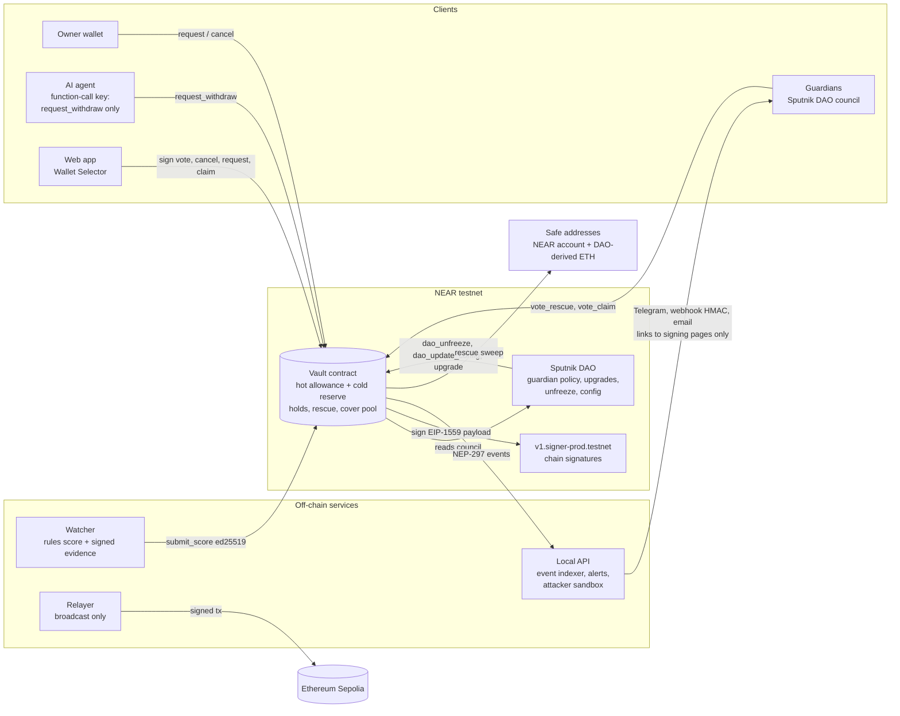

# Rescue Room

A hold-and-rescue safety layer for DAO treasuries and AI agents on NEAR, with Sepolia ETH controlled through NEAR chain signatures.

When a stolen key or a confused agent starts moving money, the vault holds the withdrawal, a watcher explains why it looks risky, and guardians from your Sputnik DAO can rescue the funds to a pre-set safe address. Small everyday spends still go through instantly.

> Status: phase 3, NEAR testnet and Ethereum Sepolia only. Not audited. Do not use with real funds.
>
> Live app: **https://rescueroom.vercel.app** (create your own vault, dashboard, wallet signing pages, audit log, alerts, simulate an attack on your vault, public attacker sandbox). Defender health: **https://rescueroom-defender.fly.dev/health**.

## Architecture



## How it works

| Piece | What it does |
| --- | --- |
| Hot allowance | Spends up to a limit per rolling window execute instantly (NEAR and Sepolia ETH tracked separately). |
| Risk-scored holds | Anything beyond the allowance waits. Hold length comes from a 0-100 risk score: 0-29 none, 30-59 1h, 60-79 3h, 80+ 6h, never below `hold_floor_secs` (30 min on the demo vault). Unscored requests get the longest hold. A demo divisor turns hours into minutes. |
| Watcher (off-chain) | Deterministic rules score each held request (new destination, chunked drain, unusual size, share of reserve, off-rhythm time, signing-pattern change, agent paying an unlisted address, fresh whitelist). It hashes an evidence bundle, signs `rescueroom-score:v1:<vault>:<id>:<score>:<confidence>:<sha256>` with an ed25519 key, and the contract verifies that signature before storing the score. The optional LLM explainer (NEAR AI Cloud) only writes the explanation. |
| Owner cancel | The owner can cancel any held request instantly. |
| Guardians | Members of a role (default `council`) in an existing Sputnik DAO, synced on-chain from `get_policy`. Rescue needs `quorum_pct` of guardians and at least `min_distinct` approvers. |
| Rescue | Blocks the request, cancels every other open request, revokes the agent key that made it, sweeps the NEAR reserve (or signs the ETH amount) to the safe address, and freezes the vault until a DAO proposal calls `dao_unfreeze`. |
| Chain signatures | For Sepolia ETH the vault builds the EIP-1559 transaction itself (RLP and keccak in the contract), asks `v1.signer-prod.testnet` to sign it, and stores the signature. The relayer only broadcasts. |
| Cover pool | Underwriters deposit NEAR. Premiums are priced from the vault's own risk posture. Payouts are capped per incident and need the guardian quorum. Cover is for what holds cannot stop: losses inside the hot allowance. |
| Agent keys | `add_agent_key` puts a function-call key on the vault that can only call `request_withdraw`. A rescue revokes it. |
| No owner backdoor | The vault account has no access keys after deployment (`scripts/lock-vault.mjs`). Code changes only happen through a guardian DAO proposal that calls `upgrade`, which only accepts the DAO as caller and runs `migrate`. |
| Audit log | Every action emits a NEP-297 event (`standard: "rescueroom"`). The local API indexes them from testnet and the app shows each with an explorer link. |
| Alerts | Event-driven: holds (score 30+), rescues, claims, unfreezes, upgrades and failures go to Telegram, a signed webhook and email. Buttons only open signing pages that show the exact call. |
| Attacker sandbox | "Run attacker" on the "Try to drain it" page runs the scripted drain against a separate sandbox vault through the local API (rate limited), streams each step and shows hot allowance lost against reserve kept. The vault resets after each run. |

## Live on NEAR testnet

Current ids are in [`deploy/testnet.json`](deploy/testnet.json) and [`deploy/sandbox.json`](deploy/sandbox.json).

| | Account |
| --- | --- |
| Demo treasury vault (locked, v1.3.0) | [`vault-v2.rescueroom-j60ox4.testnet`](https://testnet.nearblocks.io/address/vault-v2.rescueroom-j60ox4.testnet) |
| Attacker sandbox vault (locked) | [`sandbox.rescueroom-j60ox4.testnet`](https://testnet.nearblocks.io/address/sandbox.rescueroom-j60ox4.testnet) |
| Guardian DAO (council g1, g2, g3; 2 of 3) | [`rescueroom-j60ox4-guardians.sputnik-v2.testnet`](https://testnet.nearblocks.io/address/rescueroom-j60ox4-guardians.sputnik-v2.testnet) |
| Vault's Sepolia address (MPC path `rescueroom-eth-1`) | [`0xFAF0Db5471b9DfD6876D349CBcAe33a6985ED31f`](https://sepolia.etherscan.io/address/0xFAF0Db5471b9DfD6876D349CBcAe33a6985ED31f) |
| Sepolia safe address (derived from the DAO account) | [`0xf55b4654d6761e1F3EdEDD2f1c480FB4fD97911F`](https://sepolia.etherscan.io/address/0xf55b4654d6761e1F3EdEDD2f1c480FB4fD97911F) |

## Live Sepolia broadcasts

Real Sepolia transactions signed by a Rescue Room vault through NEAR chain signatures (MPC `v1.signer-prod.testnet`) and broadcast by the relayer. Log: [`deploy/sepolia-live.json`](deploy/sepolia-live.json), script: `scripts/sepolia-live.mjs`.

| | Sepolia tx | Result |
| --- | --- | --- |
| Hot-allowance send, 0.001 ETH (request #19, nonce 1) | [`0x80144535…57fdb1`](https://sepolia.etherscan.io/tx/0x8014453541d2255e7fe17b03ab002489bb9a727e767bb17f3617f069e957fdb1) | mined, fee 0.000041 ETH |
| Rescue of a held 0.01 ETH request to the DAO safe address (request #20, nonce 2) | [`0xe7d3bd40…2275f7`](https://sepolia.etherscan.io/tx/0xe7d3bd40c7bcc737ab0a8b9a088330356b2db918918a3888e55fad2c172275f7) | mined, fee 0.000041 ETH |

Signer: `vault.rescueroom-j60ox4.testnet`, Sepolia address [`0x89250Ea4…179B74`](https://sepolia.etherscan.io/address/0x89250Ea451fE4141aE4C31584E41841f53179B74). The first attempt ([`0xc6b51cca`](https://sepolia.etherscan.io/tx/0xc6b51cca4295135ae7efb295c2047993c9c801b3b14aa9393747aa17672118d1)) used a 21,000 gas limit and ran out of gas: Sepolia now charges about 207k gas for a value transfer that creates a new account. A DAO proposal raised the vault's gas limit to 220k (cap 2 gwei, tip 0.2 gwei) and called the new `dao_resync_evm_nonce`, which rewinds the vault's nonce to the chain nonce and marks stale signed transactions as superseded so one unmineable transaction cannot block the queue.

## Live explanations

The watcher sends its evidence bundle (canonical JSON: request, signals, score, explanation) with every score. Since v1.3.0 the vault checks that the bundle's sha256 equals the signed `evidence_hash` and emits it in an `evidence_published` NEP-297 event. Hold pages read that event through `/api/events`, hash it again in the browser, and show the explanation with "published on-chain, hash verified". New explanations appear on the hosted site within about 30 seconds, without a redeploy. Bundles over 6 KB are rejected; older vaults ignore the extra argument and the page falls back to the watcher's evidence file.

## Wallet signing tests

`e2e/wallet-e2e.mjs` drives the real app through NEAR Wallet Selector and MyNearWallet, with the wallet site replaced by a scripted test wallet that signs with local testnet keys (they never enter the page). For each flow it checks that the transaction the wallet receives or the page broadcasts matches the page's NEAR CLI fallback exactly: signer, contract, method, arguments, gas and deposit. Flows: new withdrawal, guardian rescue vote, cancel, buy cover (deposit, wallet popup path), file claim, guardian claim approval. Results: [`deploy/wallet-e2e.json`](deploy/wallet-e2e.json). Meteor and HERE, and MyNearWallet's own approval screen, still need a manual click.

## Create your own vault

Anyone with a testnet wallet can create a vault at **/app/new**. The factory `factory.rescueroom-j60ox4.testnet` (owned by the guardian DAO) creates `<name>.factory.rescueroom-j60ox4.testnet` with the caller as owner, in one signed transaction.

- **One-click demo vault**: guardians g1, g2, g3 (demo guardians run by Rescue Room, 2 of 3), your account as the safe, 0.3 NEAR a day hot allowance, holds of 1 to 6 hours on a demo clock (1 hour passes in 1 minute). Attach 1.506 NEAR: 1.5 funds your vault and a rescue sends it back to you, 0.006 pays the factory registry entry. Then press **Simulate an attack**.
- **Custom vault**: guardians as a list of NEAR accounts (a council that votes on the vault directly, with quorum and a minimum of distinct approvers) or an existing Sputnik DAO and role; a safe NEAR account; an optional Sepolia safe address (Sepolia stays off without one); the hot allowance and window; hold tiers and floor. You attach only storage: 0.02 NEAR stays in your vault for its state and 0.006 NEAR covers the registry entry (0.026 NEAR in total), plus any first deposit.
- The vault code is a NEAR global contract (NEP-591) deployed once by hash, so a new vault stores a reference instead of 350 KB of code. Factory vaults have no access keys except the agent keys their owner adds. Council vaults have no DAO, so nobody can change their config or code.
- **Fund and agents** (`/app/connect`): deposit NEAR, see the vault's derived Sepolia address, and create an agent key in the browser: a function-call key limited to `request_withdraw`; only its public key goes on chain. The page gives a copyable near-api-js snippet.
- **Vault picker**: the sidebar lists the demo vaults, the vaults you own (`vaults_of`) and recently opened ones. Every page works for any factory vault; links carry `?vault=`.
- **Alerts per vault**: open `t.me/rescueroom_bot?start=<vault name>` and press Start to link a chat (`/stop <name>` unlinks); optionally set an https webhook (stored in the factory, signed with ed25519 over `timestamp.body`, header `x-rescueroom-signature-ed25519`, key shown on the Alerts page).

Factory tests: `cd contracts/factory && cargo test` (14). Deploy: `node scripts/deploy-factory.mjs` (`--lock` deletes the factory's full-access key).

## Simulate an attack on my vault

On a factory vault, **Simulate an attack** asks the defender for a fresh key pair and returns only the public key. The owner signs `add_agent_key(public_key, "attack-sim", ttl_secs = 600)`: a function-call key for `request_withdraw` that expires on its own (`revoke_expired_agent_keys`, swept by the defender every minute; a rescue revokes it at once). The defender then streams: two spends inside the allowance, a drain of 90% of the reserve that is held, the watcher score and explanation, and the response. On demo vaults g1 and g2 vote to rescue; otherwise the page links your guardians to the rescue page and you to cancel. The allowance spends are returned afterwards. **Small batch drain** instead makes five small instant spends that stay inside the allowance, to show the pattern rules below. Limits: one run per vault every 3 minutes, 6 per IP per hour, 80 a day.

## Pattern rules for small instant withdrawals

The vault only holds requests over the allowance, so an attacker can try to stay under it. The defender's watcher also checks recent hot spends per vault (`watcher/src/patterns.js`, tests in `watcher/test/patterns.test.js`):

- **burst**: 5 or more hot spends within 10 minutes, or 60% or more of the window allowance within an hour;
- **drip**: 80% or more of the allowance used in 3 consecutive windows, or 3 or more hot spends to a new recipient (first seen within 24 hours, not whitelisted, not the safe).

A finding sends a "Pattern alert" (Telegram and the vault's webhook, or the operator channels for the demo treasury) with the evidence and a suggestion: tighten the allowance or remove the agent key. It shows on the Overview and the Audit log. It only recommends; it never changes anything on chain.

## Hosting

The web app and a small public API run on Vercel (`vercel/`, assembled by `node scripts/vercel-build.mjs` into `.vercel-out/`).

| Route | What it does | Keys |
| --- | --- | --- |
| `/api/events` | NEP-297 events from the FastNEAR tx API, CDN-cached 15s | none |
| `/api/alerts` | alerts derived from the same events and rules | none |
| `/api/webhook` | demo receiver that verifies signed alert webhooks | `ALERT_WEBHOOK_SECRET` |
| `POST /api/sandbox/run` | runs the attacker and streams steps (SSE in the response) | `SANDBOX_AGENT_KEY` only |

The public sandbox function holds only the sandbox agent key: a function-call key on the sandbox vault that can call `request_withdraw` and nothing else. The defenders (watcher scoring, two guardian votes, DAO unfreeze, refunds, re-adding the same agent key) run in the Fly.io defender (below); no owner, guardian, DAO, watcher or relayer key is configured on Vercel. If the defenders are offline, the run still shows the drain held by the vault. Limits are checked on chain, so they hold across instances: one run at a time, a 90s global cooldown, 40 runs a day, plus 2 runs per 10 minutes per IP.

Telegram: start a chat with the bot and send `/start`. When `TELEGRAM_CHAT_ID` is unset, the API picks the chat id from the first private `/start`, saves it to `~/.rescueroom/telegram.json` (mode 600) and `.env`, and sends a test alert. Alert buttons open the hosted signing pages. Alerts from the public sandbox vault are logged but not delivered unless `ALERT_SANDBOX=1`.

## The defender on Fly.io

One process, `server/src/defender.js`, runs as the Fly app `rescueroom-defender` (one shared-cpu-1x machine with 512 MB, always on, a 1 GB volume at `/data`). It:

- discovers every factory vault from the factory (`list_vaults`, every 30s) and indexes their events with the demo and sandbox vaults;
- scores held requests (watcher, NEAR AI explanations limited to 6 per vault per hour) and checks the pattern rules;
- relays MPC-signed Sepolia transactions for vaults with a Sepolia safe;
- delivers alerts: the demo treasury to the operator channels, factory vaults to their linked Telegram chats and webhook, the public sandbox muted;
- runs the Telegram bot that links chats (`/start <vault>`), the sandbox defender, the demo-guardian auto-votes for one-click demo vaults, the attack simulator and the expired-key sweeper;
- serves `GET /health` (state only, never secrets), `GET /alerts?vault=`, `GET /patterns?vault=`, `POST /sim/prepare` and `POST /sim/start` (SSE).

Keys arrive as one Fly secret, `RR_KEYS`, and are never written to disk: watcher, evidence signing, relayer, the demo guardians g1 to g3, the sandbox owner, safe and agent key, the attacker (simulations) and the webhook signing key. The main owner, factory and vault keys are not on Fly. Deploy with `node scripts/deploy-defender.mjs` (stages secrets through stdin, then `fly deploy`; `FLY_IMAGE=<ref>` deploys a prebuilt image when the remote builder is down). Reads rotate across RPCs on rate limits (`NEAR_RPC_FALLBACKS`); transactions use the primary RPC only.

If the defender stops, every vault still enforces its holds; requests wait unscored at the longest hold and nobody is alerted. `scripts/run-api.sh` (the old single-host loop, `server/src/index.js`) is kept as a fallback; do not run it while the Fly app is up, or two defenders would vote and reset at once.

## Setup

Requirements: Node 22+, Rust stable 1.95+ with `wasm32-unknown-unknown`, `cargo-near` 0.23, and a funded NEAR testnet account.

```bash
npm install && (cd web && npm install)
cp .env.example .env            # every integration is optional; see below
npm test                        # 35 contract tests + 14 watcher, alert and API tests
npm run build:contract

node scripts/deploy.mjs <main>.testnet          # roles, guardian DAO, demo vault
node scripts/lock-vault.mjs                     # delete the vault's full-access key
npm run deploy:sandbox                          # separate vault for the public attacker sandbox
node scripts/lock-vault.mjs sandbox.<main>.testnet

npm run e2e                     # every scenario on testnet, logs to deploy/e2e-*.json
npm run api                     # indexer, alerts and sandbox API on 127.0.0.1:8787
npm run web                     # http://127.0.0.1:5173 (proxies /api)
```

Keys are generated into `~/.rescueroom/keys/*.json` with mode 600. The web app never sees a key; it signs through the user's own wallet.

Optional integrations, each switched on by its env vars in `.env`:

| Feature | Env vars | Without them |
| --- | --- | --- |
| LLM explanation of scores | `NEAR_AI_API_KEY`, `NEAR_AI_MODEL` | template explanation |
| Telegram alerts | `TELEGRAM_BOT_TOKEN`, `TELEGRAM_CHAT_ID`, and a public https `APP_URL` for URL buttons | skipped (links go in the text if `APP_URL` is not https) |
| Webhook alerts | `ALERT_WEBHOOK_URL`, `ALERT_WEBHOOK_SECRET` | skipped |
| Email alerts | `SMTP_URL`, `ALERT_EMAIL_TO`, `ALERT_EMAIL_FROM` | skipped |
| Sepolia sends | ETH at the vault's Sepolia address (gas) | signatures are produced and verified, not broadcast |
| Public sandbox | `SANDBOX_AGENT_KEY` on the host, defenders running via `npm run api` | localhost only |

Webhook receivers verify `X-RescueRoom-Signature: sha256=<hex>` = HMAC-SHA256(secret, `<X-RescueRoom-Timestamp>.<raw body>`) and reject timestamps older than 5 minutes. `verifyWebhook()` in `alerts/src/webhook-verify.js` does both.

## Upgrades go through the DAO

The vault account has no access keys, so no one can deploy code or sign as the vault. To upgrade:

```bash
node scripts/dao-upgrade.mjs path/to/new.wasm 1.1.1
```

This opens a Sputnik `FunctionCall` proposal to `vault.upgrade(<wasm bytes>)`; when two guardians approve, the DAO calls it, the vault checks the caller is the DAO, deploys the code and calls `migrate`. Sputnik's `UpgradeRemote` blob path keeps only 15 Tgas for itself after forwarding the code, which a ~345 KB wasm exceeds on the testnet factory version, so the inline path is the default (`UPGRADE_MODE=blob` uses the blob path for smaller code).

Proof on testnet: DAO proposal 21 upgraded 1.1.1 to 1.3.0 in [`5GhAF6V9`](https://testnet.nearblocks.io/txns/5GhAF6V97TciXsXxfbeP8h9jav4HMUzao3w44TfFYz6M). Earlier: full-access key deleted in [`9rfXEqGQ`](https://testnet.nearblocks.io/txns/9rfXEqGQnhTbQCMS3Xde3FW8E741me7FqtySwqWJxicV); DAO proposal 7 upgraded 1.1.0 to 1.1.1 in [`4q2TYvmy`](https://testnet.nearblocks.io/txns/4q2TYvmy6orAuEsbLMSo4fE7EJwnj9g9SLrbGckyJ1VJ) (events `upgrade_started`, `upgraded`). A direct call to `upgrade` from any other account fails with "only guardian DAO".

## Demo run

All scenarios were re-run on the locked, upgraded vault on 10 Nov 2026. Times are WAT.

**Rescue: stolen agent key drains in chunks**

| WAT | Step | Tx |
| --- | --- | --- |
| 11:37:16 | Underwriter funded cover pool with 2 NEAR | [`5Z22u1Z8`](https://testnet.nearblocks.io/txns/5Z22u1Z8Y6uWVJ4YZn4nFi2iwHCKcvpnHSu95N7NiRoS) |
| 11:37:19 | Owner bought 1 NEAR of cover (premium 0.0268 NEAR) | [`Cv3uG4tX`](https://testnet.nearblocks.io/txns/Cv3uG4tXuvyeQmLyVsrnwBUZoHmCS96FvTQULaVMnQTu) |
| 11:37:22 | Owner gave the AI agent a request-only key | [`EasDaZsN`](https://testnet.nearblocks.io/txns/EasDaZsNKvFJhJpEvbK5YRhEr46mKYwW1my1zwxeXJxx) |
| 11:37:26 | Attacker (stolen agent key) requested 0.8000 NEAR | [`AVXY1cKz`](https://testnet.nearblocks.io/txns/AVXY1cKzzGXCQnnPrnzPAuRqY8F1YWokrPLScZBqXo6S) |
| 11:37:28 | Attacker (stolen agent key) requested 0.5000 NEAR | [`7H6yUk3H`](https://testnet.nearblocks.io/txns/7H6yUk3HDqdvXBR8DyanugkgxBRy6JR64JrXpKEhJjuk) |
| 11:37:29 | Attacker (stolen agent key) requested 2.0000 NEAR | [`GbJQXoH3`](https://testnet.nearblocks.io/txns/GbJQXoH3UbsRoTEKHJ7K4sBfbvt4jXuVmJcJDWKcyz3Z) |
| 11:37:34 | Watcher scored the drain (score 65, signals chunked_drain,large_share_of_reserve,agent_unlisted_destination) | |
| 11:37:37 | Guardian g1 voted rescue | [`GWwCmHEc`](https://testnet.nearblocks.io/txns/GWwCmHEcasKwFr9bH5qFwT5DZiztzeBT5PHZkYvgteiy) |
| 11:37:40 | Guardian g2 voted rescue -> quorum | [`G1NGv51w`](https://testnet.nearblocks.io/txns/G1NGv51wQ6opYR46nyWfbtTTPnvKCHUtHReaPZABJH1m) |
| 11:37:40 | Rescued: vault frozen, funds at safe address (frozen true; safe balance 2.7874 NEAR) | |
| 11:37:43 | Owner filed cover claim | [`BpkLrLjS`](https://testnet.nearblocks.io/txns/BpkLrLjSQfsQkX2tVmqmbvqBJro4MXrtFSva83kGBNQm) |
| 11:37:48 | Guardians approved -> cover paid (payout 0.8000 NEAR; solvency 61220 bps) | [`6ZpaeM5H`](https://testnet.nearblocks.io/txns/6ZpaeM5HvEdmYkbEwovEWoRVdTPEcPBJMHFzAgVDJson) |
| 11:37:50 | Guardian opened DAO proposal to unfreeze (proposal 12) | [`HMe1M3aY`](https://testnet.nearblocks.io/txns/HMe1M3aYa5nE6fsFu8M3453hmn263QXM2dTLy3NkZqXi) |
| 11:37:56 | DAO approved -> dao_unfreeze executed (frozen now false) | [`54APhGzJ`](https://testnet.nearblocks.io/txns/54APhGzJXjba2CLBXuARZBRS3t8wAmZcdAqwkounUFnB) |
| 11:37:59 | Safe address returned funds to vault for the next demo | [`Ekpydu6h`](https://testnet.nearblocks.io/txns/Ekpydu6hCFxukd3MnhJG7a3J8mo3yxZyiHrbNaxKYSFX) |

**False alarm: owner cancels a flagged vendor payment**

| WAT | Step | Tx |
| --- | --- | --- |
| 11:35:57 | New vendor account (never paid before) (vendor-mwak17i2.rescueroom-j60ox4.testnet) | |
| 11:35:59 | Vendor payment requested (beyond allowance) | [`5dA5vTdw`](https://testnet.nearblocks.io/txns/5dA5vTdwKS7SijngSpSdo3Kf6e8KEe2L7cDUv6hmEijC) |
| 11:36:01 | Watcher flagged it (score 55, hold until 2026-11-10T10:36:58.498Z) | |
| 11:36:04 | Owner cancelled own flagged request | [`2gnPn7Gu`](https://testnet.nearblocks.io/txns/2gnPn7GuosAQ9zdRRUCW13XCb8uxVk5qSEj4a9ki8LzQ) |
| 11:36:05 | Owner whitelisted vendor | [`7aoXqN7Z`](https://testnet.nearblocks.io/txns/7aoXqN7ZULV3cy9LjTMoqjY3zToU4LVncqgw6Vyq9zpd) |
| 11:36:08 | Resent payment | [`DKpmhdGi`](https://testnet.nearblocks.io/txns/DKpmhdGiVuSVD79xCfkYrTGqTP7D427ksd1LNpGFDoiR) |
| 11:36:10 | Watcher rescored (score 40, signals fresh_whitelist,chunked_drain) | |
| 11:37:14 | Vendor paid after hold (Executed) | [`8Dzr1PeS`](https://testnet.nearblocks.io/txns/8Dzr1PeSUWXJaVpHtH6k1DeSCsDcxfKhH67ewZ1sxeJ) |

**Cover payout for the hot-allowance loss**

| WAT | Step | Tx |
| --- | --- | --- |
| 11:37:16 | Underwriter funded cover pool with 2 NEAR | [`5Z22u1Z8`](https://testnet.nearblocks.io/txns/5Z22u1Z8Y6uWVJ4YZn4nFi2iwHCKcvpnHSu95N7NiRoS) |
| 11:37:19 | Owner bought 1 NEAR of cover (premium 0.0268 NEAR) | [`Cv3uG4tX`](https://testnet.nearblocks.io/txns/Cv3uG4tXuvyeQmLyVsrnwBUZoHmCS96FvTQULaVMnQTu) |
| 11:37:43 | Owner filed cover claim | [`BpkLrLjS`](https://testnet.nearblocks.io/txns/BpkLrLjSQfsQkX2tVmqmbvqBJro4MXrtFSva83kGBNQm) |
| 11:37:48 | Guardians approved -> cover paid (payout 0.8000 NEAR; solvency 61220 bps) | [`6ZpaeM5H`](https://testnet.nearblocks.io/txns/6ZpaeM5HvEdmYkbEwovEWoRVdTPEcPBJMHFzAgVDJson) |
| 11:37:59 | Cover already paid for the latest agent loss (during the attack run) (claim 1, payout 0.8000 NEAR) | |

**Sepolia rescue through chain signatures**

| WAT | Step | Tx |
| --- | --- | --- |
| 11:38:01 | 0.05 ETH request beyond allowance -> held | [`3ymHNZVR`](https://testnet.nearblocks.io/txns/3ymHNZVRKA4e8kxaf5GT8NWnRqyiumxadyQs1X1mA2FJ) |
| 11:38:03 | Watcher scored it (score 50) | |
| 11:38:12 | Guardians g2 + g3 rescued -> MPC signs transfer to safe address | [`HGLwXHEB`](https://testnet.nearblocks.io/txns/HGLwXHEBxNpf7xWpapaPdnKpgwbcCv6xty7yH5N1gpPq) |
| 11:38:13 | Rescue tx verified (to 0xf55b4654d6761e1F3EdEDD2f1c480FB4fD97911F (safe), from 0xFAF0Db5471b9DfD6876D349CBcAe33a6985ED31f (vault), OK) | |
| 11:38:15 | Guardian opened DAO proposal to unfreeze (proposal 13) | [`4c9v7QLD`](https://testnet.nearblocks.io/txns/4c9v7QLDYdwpu7n4Zd5a1ngdEc5AiZvy6abaTXEdatUA) |
| 11:38:21 | DAO approved -> dao_unfreeze executed (frozen now false) | [`47WstV8m`](https://testnet.nearblocks.io/txns/47WstV8mudYAjoyAwvyYw7uSN7hat9u5XNPmaof5kJo1) |

**Hot spend and chain-signature check**

| WAT | Step | Tx |
| --- | --- | --- |
| 11:35:51 | ETH request (hot allowance) -> MPC sign | [`7oqq2LsV`](https://testnet.nearblocks.io/txns/7oqq2LsVbLYJijCfm9bcaB9q2omQ71yYDnykD2KN6Y5u) |
| 11:35:51 | MPC signature verified | |
| 11:35:55 | Hot spend executed instantly (status Executed) | [`2pF2vT2c`](https://testnet.nearblocks.io/txns/2pF2vT2cxovnzm2PNG73AVhP8hyE51LqHDjth8gSau5N) |

**Attacker sandbox** (`sandbox` vault, through the local API): each run spends the 0.3 NEAR hot allowance, gets two drain requests held (score 95), and two guardian votes move the rest of the reserve to the sandbox safe account (about 6.1 NEAR kept against 0.3 NEAR lost), then the vault resets.

## Agent wallet snippet

Give an agent a key that can only ask for withdrawals. The owner adds it once:

```bash
near contract call-function as-transaction vault-v2.rescueroom-j60ox4.testnet add_agent_key \
  json-args '{"public_key":"ed25519:<agent public key>","label":"ops-agent"}' \
  prepaid-gas '100 Tgas' attached-deposit '1 yoctoNEAR' \
  sign-as <owner>.testnet network-config testnet sign-with-keychain send
```

The agent then signs as the vault account with that function-call key (near-api-js 7):

```js
import { Account, JsonRpcProvider, KeyPairSigner } from 'near-api-js';

const VAULT = 'vault-v2.rescueroom-j60ox4.testnet';
const provider = new JsonRpcProvider({ url: 'https://test.rpc.fastnear.com' });
// The key can only call request_withdraw on the vault. It cannot attach deposits or call anything else.
const agent = new Account(VAULT, provider, KeyPairSigner.fromSecretKey(process.env.AGENT_KEY));

const result = await agent.callFunction({
  contractId: VAULT,
  methodName: 'request_withdraw',
  args: { asset: 'Near', to: 'vendor.testnet', amount: '200000000000000000000000', memo: 'invoice 88' },
  gas: 100_000_000_000_000n,
});
// Inside the hot allowance it pays at once; beyond it the request is held, scored and visible to guardians.
const req = await provider.callFunction({ contractId: VAULT, method: 'get_request', args: { id: result } });
console.log(req.hot ? 'paid' : `held until ${new Date(Number(req.release_ms)).toISOString()}`);
```

## Repository

```
contracts/vault   Rust near-sdk 5 contract + unit tests (DAO-only upgrade, hold floor)
watcher/          rules scorer, evidence signing, explainer interface (+ tests)
alerts/           event-to-alert rules and delivery: Telegram, HMAC webhook, SMTP email (+ tests)
server/           local API: NEP-297 indexer (FastNEAR), alerts dispatcher, sandbox attacker + defenders, rate limits
vercel/           hosted API functions and vercel.json (built by scripts/vercel-build.mjs)
attacker/         scripted attacker using a stolen agent key
scripts/          deploy, lock, DAO upgrade, e2e scenarios, relayer, DAO helpers
web/              Vite + React + TypeScript dashboard with NEAR Wallet Selector
deploy/           public deployment ids and scenario logs (no secrets)
```

## Threat model

**Protects:** assets held by the vault contract (NEAR in the vault account, ETH at the vault's MPC-derived Sepolia address).

**Does not protect:** anything held elsewhere. If a key also controls other wallets, Rescue Room cannot see or stop those.

| Attacker has | What they can do | What stops them |
| --- | --- | --- |
| Agent function-call key | Call `request_withdraw` only | The hot allowance caps instant loss per window; everything else is held and scored; rescue revokes the key. Function-call keys cannot attach deposits. |
| Owner key | Request withdrawals, cancel, whitelist, add agent keys, lower allowances | Cannot raise allowances, change tiers, floor, safe addresses, guardians or watcher (DAO-only, tested). Large requests are held; fresh whitelists still score risk. |
| Deployer key | Nothing | Deleted after deployment. The vault account has zero access keys; code changes need a DAO proposal. |
| Watcher key | Submit low scores | Scores must be signed by the registered evidence key from the watcher account. A low score still cannot push a hold below `hold_floor_secs` (tested). Guardians can rescue during any hold and the owner can cancel. |
| Relayer | Broadcast or withhold signed Sepolia txs | Cannot change destination, amount, nonce or fees: they are inside the signed payload. |
| Minority of guardians | Vote rescue | Needs quorum and the distinct floor. Rescue only moves funds to the pre-set safe address. |
| Majority of guardians / DAO | Rescue, unfreeze, change config, upgrade code | This is the trust root. Choose the council accordingly; the DAO's own policy and proposal periods apply. |
| Anyone | Call `execute` after a hold; run the sandbox | Intended. `execute` only releases what passed its hold. The sandbox touches a separate vault and is rate limited on chain (one at a time, cooldown, daily cap) and per IP. |
| Hosting provider or a leaked sandbox key | Use the sandbox agent key | It is a function-call key on the sandbox vault for `request_withdraw` only; the worst case is a held drain of sandbox testnet NEAR that the defenders rescue. No privileged key is on the host. |
| Demo guardians g1, g2, g3 | Rescue or unfreeze one-click demo vaults | They are keys Rescue Room runs on the Fly defender and they vote automatically on demo vaults; the UI labels them "demo guardian, run by Rescue Room". On testnet they are also the guardian DAO council of the demo treasury. Fine for a demo, never for real funds: use your own guardians. Rescue only moves funds to the vault's safe account (on demo vaults, your own account). |
| Fly host or its secrets | Use the keys in `RR_KEYS` | Watcher: low scores still respect the floor. Relayer: cannot change Sepolia payloads. Demo guardians: see above. Attacker: only the temporary keys owners grant, which expire within 10 minutes. No owner, factory or vault key is there. |
| An agent staying under the allowance | Many small instant spends | Capped by the allowance per window. The pattern rules flag bursts and slow drips and recommend tightening the allowance or removing the key; they never act on their own. |
| Alert channel (Telegram, email, webhook) | Show a message | Alerts carry links only; every action is signed in the user's wallet after the page shows the exact call. Webhooks are signed with a timestamp (HMAC for the operator webhook, ed25519 for per-vault webhooks). |

Known limits:

- One Sepolia nonce stream. A signed tx that can never be mined blocks later ones; the DAO can call `dao_resync_evm_nonce` to rewind to the chain nonce and supersede it. Superseded signatures stay valid, so only one tx per nonce can ever be mined.
- ETH rescue moves the requested amount, not the full Sepolia balance (the contract cannot read Sepolia balances).
- Scores are rules-based. The LLM explainer only writes the explanation.
- The event indexer depends on the FastNEAR transactions API; events are cached locally and the contract state stays the source of truth.

## Hackathon

Built for the NEAR Hackathon. Tracks: Social Money (lead), Open Innovation, AI Security.
